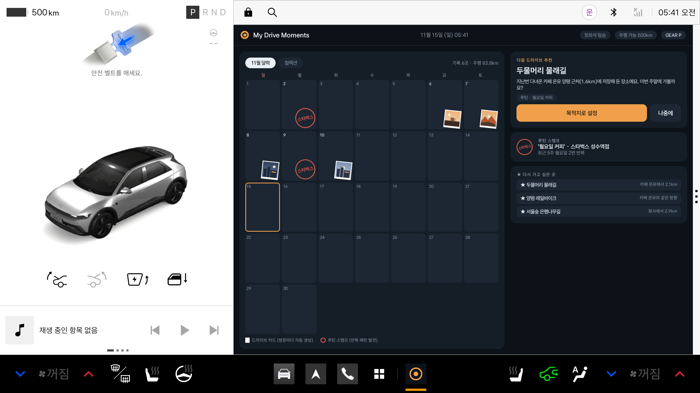
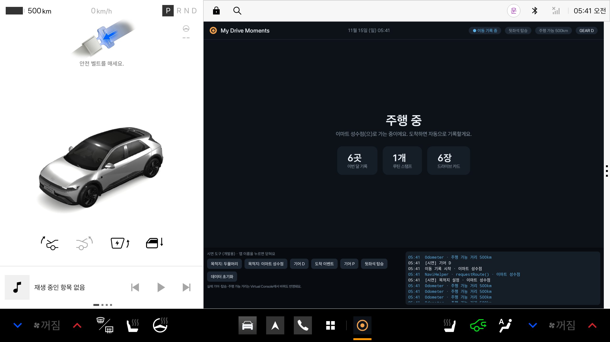
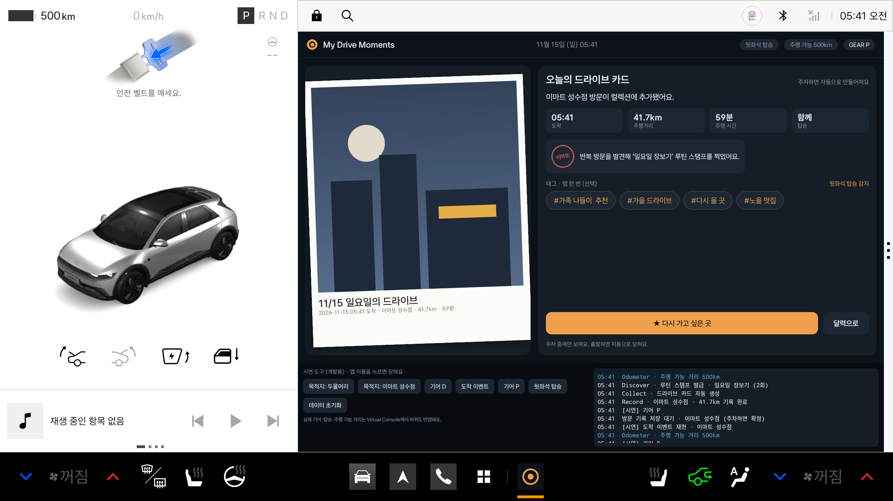
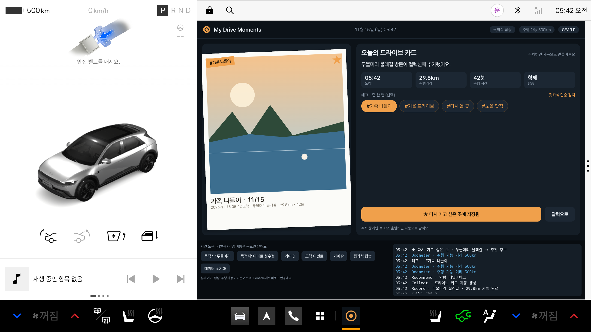
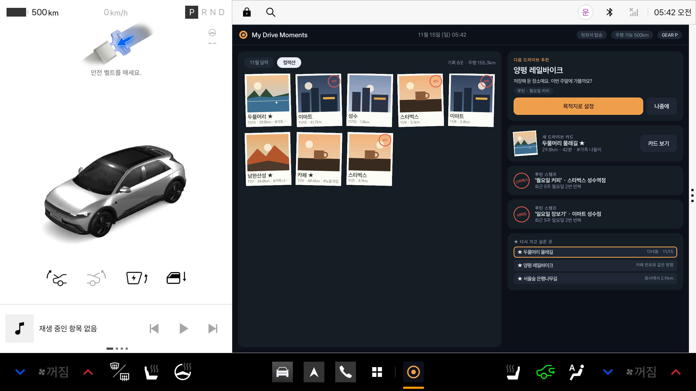

# My Drive Moments

**운전한 만큼 쌓이는 나만의 드라이브 컬렉션**

차량이 기억하는 나의 이동을 자동으로 기록하고, 반복되는 이동은 **루틴 스탬프**로, 다녀온 곳은 **드라이브 카드**로 모아 다음 목적지까지 추천하는 Pleos Connect 차량용 앱입니다. 모바일 앱 없이 차량 화면 하나에서 모든 경험이 완결됩니다.



## 핵심 구조

| 단계 | 하는 일 | 사용하는 차량 데이터 |
|---|---|---|
| **Record** | 목적지 도착 이벤트로 방문 날짜·장소·주행 정보를 자동 저장 | NaviHelper `onDestinationInfo`, `onDestinationArrived` |
| **Discover** | 같은 장소를 같은 요일에 2번 이상 가면 **루틴 스탬프** 발급 | 방문 기록(요일·장소) |
| **Collect** | 주차하면 장소·날짜·주행거리가 담긴 **폴라로이드 드라이브 카드** 자동 생성. 태그와 ★는 탭 한 번 | Vehicle `Gear`(P), `Seat` 2열 탑승 |
| **Recommend** | ★ 저장한 장소와 내비 즐겨찾기 중 주행 가능 거리 안의 곳을 추천하고 내비 목적지로 연결 | Vehicle `Odometer` 주행 가능 거리, NaviHelper `onBookmarkInfo`, `requestRoute()` |

**안전 설계:** 기어 D에서는 기록만 하고 '주행 중' 화면만 보여 줍니다. 카드·태그·추천 같은 조작 화면은 기어 P에서만 열리고, 출발하면 자동으로 닫힙니다. 글자 입력이나 사진 선택은 없습니다.

**개인정보:** 방문 기록은 차량 안(앱 내부 저장소)에만 저장되며 외부로 전송하지 않습니다.

## 화면

| 주행 중 | 루틴 스탬프 발급 + 드라이브 카드 |
|---|---|
|  |  |
| **태그 · ★ 다시 가고 싶은 곳** | **컬렉션** |
|  |  |

화면은 Pleos Connect Emulator v2.1.0(Android 14, 2560×1440)에서 캡처했습니다.

## 프로젝트 구조

```
app/src/main/java/com/mydrivemoments/app/
├── MainActivity.kt          # 진입점, 차량 화면 배율 설정
├── DriveController.kt       # 앱 상태와 Record → Discover / Collect → Recommend 흐름
├── data/
│   ├── Models.kt            # 방문, 저장 장소, 루틴 판정, 거리 계산
│   └── DriveStore.kt        # 차량 내 저장소(SharedPreferences) + 시연용 예시 데이터
├── sdk/
│   ├── VehicleBridge.kt     # Pleos Vehicle SDK: Gear, Seat, Odometer
│   └── NaviBridge.kt        # Pleos NaviHelper SDK: 목적지·도착·즐겨찾기·경로 요청
└── ui/
    ├── Screens.kt           # 홈(달력/컬렉션), 주행 중, 드라이브 카드, 시연 도구
    └── Art.kt               # 장소 일러스트, 루틴 스탬프, 미니 폴라로이드
docs/
├── prototype/index.html     # 웹 인터랙티브 프로토타입(기획 단계 시안)
└── screenshots/             # 에뮬레이터 캡처
```

## SDK와 권한

| SDK | 버전 | 권한 |
|---|---|---|
| `ai.pleos.playground:Vehicle` | 2.3.2 | `pleos.car.permission.CAR_DRIVE`, `pleos.car.permission.CAR_SEATS` |
| `ai.pleos.playground:NaviHelper` | 3.0.5 | `pleos.car.permission.NAVI_ROUTE`, `pleos.car.permission.NAVI_ROUTE_SEARCH` |

두 SDK 모두 Pleos Playground에서 별도 신청 없이 사용할 수 있으며, Maven 저장소 `https://nexus-playground.pleos.ai/repository/maven-releases/`에서 받습니다.

## APK 다운로드

**[Releases › v1.0.0 › app-debug.apk](../../releases/latest)** 에서 받을 수 있습니다. (디버그 서명 APK)

## 테스트 환경

| 항목 | 내용 |
|---|---|
| 에뮬레이터 | Pleos Connect Emulator v2.1.0 (Android 14, API 34, arm64), 2560×1440 |
| 차량 서비스 | Pleos Vehicle Service, Pleos Navigation (에뮬레이터 기본 탑재) |
| 개발 도구 | Android Studio, Android Gradle Plugin 9.5.1, Kotlin 2.2.10, Jetpack Compose |
| 앱 요구사항 | minSdk 28 · targetSdk 37 · `android.hardware.type.automotive` |
| 테스트한 Mac | Apple Silicon (arm64), macOS |

**필요한 설정**

- 일반 Android 휴대폰·에뮬레이터에는 설치되지 않습니다(차량 전용 앱). **Pleos Connect 전용 에뮬레이터**가 필요합니다.
- Pleos 에뮬레이터 설치: Android Studio → Settings → Languages & Frameworks → Android SDK → SDK Update Sites에 `https://nexus-playground.pleos.ai/repository/raw-releases/connect-avd/2.x/crp-arm64-sys-img.xml`(Apple Silicon) 추가 → SDK Platforms에서 *Pleos Connect v2.1.0 APIs arm64 System Image* 설치 → Device Manager에서 Automotive › Pleos Connect 기기 생성(RAM 4GB, Cold boot). 자세한 내용은 [Pleos Connect Emulator 설치 및 실행](https://document.pleos.ai/docs/pleos-only/getting-started) 참고.
- 별도 API 키나 로그인은 필요 없습니다. 사용하는 Vehicle·NaviHelper SDK는 신청 없이 사용할 수 있습니다.

## 실행 방법

**APK로 실행 (권장)**

1. Pleos Connect 에뮬레이터를 실행합니다.
2. Releases에서 받은 APK를 에뮬레이터 창에 끌어다 놓거나, 터미널에서 설치합니다.
   ```bash
   adb install app-debug.apk
   ```
3. 화면 하단 독 또는 앱 목록에서 **My Drive Moments**를 실행합니다.

**소스에서 빌드**

```bash
./gradlew assembleDebug    # APK: app/build/outputs/apk/debug/app-debug.apk
./gradlew installDebug     # 실행 중인 Pleos 에뮬레이터에 바로 설치
```

Android Studio에서 이 폴더를 열고 실행 기기로 Pleos Connect 에뮬레이터를 선택한 뒤 ▶ Run을 눌러도 됩니다.

## 시연 방법

에뮬레이터에서는 내비게이션으로 실제 이동해 도착시키기 어렵기 때문에, 앱 상단의 **앱 이름 'My Drive Moments'를 누르면 시연 도구**가 열립니다. 목적지 설정, 기어 D/P, 도착 이벤트, 뒷좌석 탑승을 버튼으로 재현할 수 있고, 오른쪽에 앱이 받은 SDK 이벤트 로그가 표시됩니다. 기어·탑승·주행 가능 거리는 Pleos Virtual Console에서 바꿔도 그대로 반영됩니다.

1. **데이터 초기화** — 예시 기록(지난주 같은 요일 이마트 방문, 월요일 스타벅스 루틴 등)으로 시작
2. **목적지: 이마트 성수점 → 기어 D → 도착 이벤트 → 기어 P** — 드라이브 카드 생성 + 루틴 스탬프 발급
3. **달력으로 → 다음 드라이브 추천 → 목적지로 설정** — 내비게이션으로 경로 요청
4. **목적지: 두물머리 → 기어 D → 도착 이벤트 → 기어 P → #가족 나들이 → ★ → 컬렉션 탭**

## 알려진 제한

- Vehicle SDK의 기어·주행 가능 거리 API는 Android Automotive 표준 속성(`GEAR_SELECTION`, `RANGE_REMAINING`)으로 이전 예정이라는 deprecated 안내가 있습니다. 현재 버전에서는 정상 동작하며, 이후 표준 API로 옮길 계획입니다.
- 실제 내비게이션의 도착 이벤트(`onDestinationArrived`) 수신 코드는 포함되어 있으나, 에뮬레이터 시연은 시연 도구로 재현했습니다.
